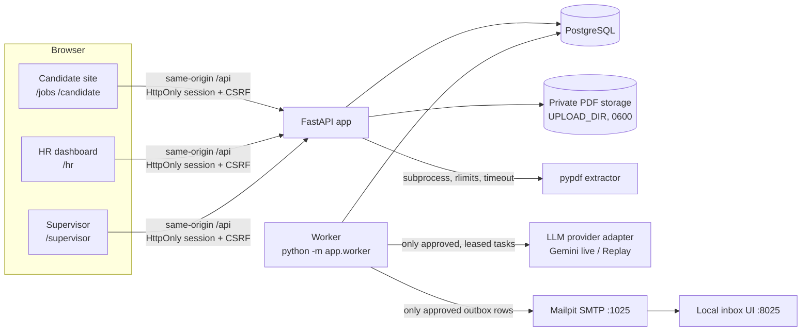
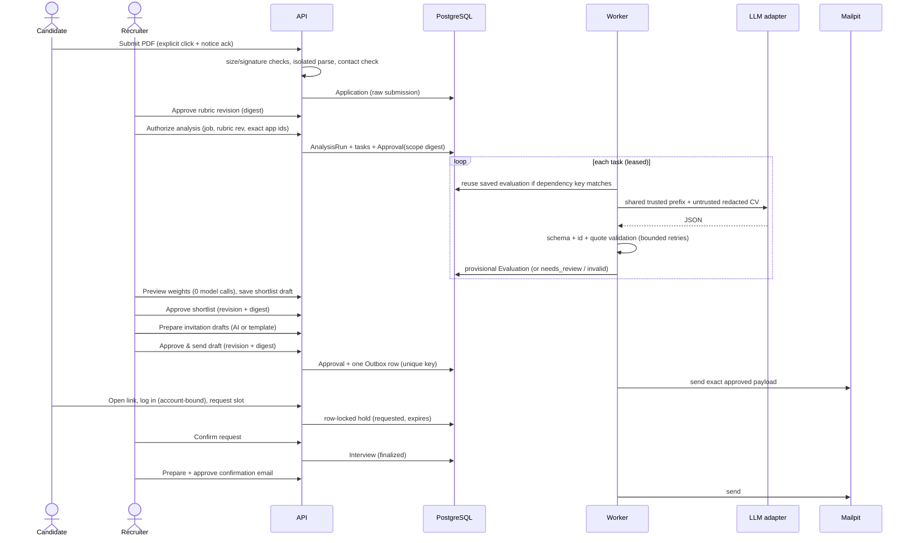

# Architecture

Talent Detective is a **modular monolith**: one React frontend, one FastAPI application (plus a worker
process from the same codebase), one PostgreSQL database, private local file storage, and Mailpit as the
only SMTP destination.

## Components

| Module | Responsibility |
| --- | --- |
| `app/routers/auth.py` | Registration (candidate only), login per portal, sessions, CSRF bootstrap |
| `app/routers/candidate.py` | Careers listing, PDF application, own applications/documents, invitations, booking requests |
| `app/routers/hr_jobs.py` | Jobs, rubric & weight revisions, application table, analysis runs, ranking, shortlists |
| `app/routers/hr_ops.py` | Invitation/confirmation drafts, approve-and-send, calendar slots, booking decisions, approvals inbox |
| `app/routers/supervisor.py` | Staff accounts, roles, job assignments, AI mode switch, overview, approvals log, audit |
| `app/services/intake.py` + `pdf_worker.py` | Upload validation, private storage, isolated parsing, contact checks |
| `app/services/evaluation.py` | Rubric schema, prompt construction (cacheable prefix), strict output validation, quote checks |
| `app/services/llm/` | Provider interface, Gemini adapter, Replay adapter, mode switch, RPM pacing, daily budget |
| `app/services/analysis.py` | Run authorization, leased durable tasks, saved-evaluation reuse, quota pause/resume |
| `app/services/ranking.py` | Deterministic scoring (lower/upper bound, coverage), proposal, review list, shortlist snapshots |
| `app/services/email.py` | Draft preparation, digest-bound approval, outbox, Mailpit dispatch, delivery-unknown recovery |
| `app/services/booking.py` | Slot creation (advisory-locked overlap check), holds, HR decisions, expiry sweeper |
| `app/worker.py` | Loop: recover leases → expire holds → claim analysis tasks → dispatch outbox |

## Data model (main tables)

`users`, `user_sessions`, `company`, `jobs`, `job_assignments`, `rubric_revisions` (immutable, approved),
`weights_revisions`, `resume_documents`, `parse_cache`, `applications`, `analysis_runs`, `analysis_tasks`,
`ai_call_log`, `evaluations`, `shortlists` (revisioned snapshots), `invitations`, `email_drafts`, `outbox`,
`approvals`, `interview_slots`, `booking_requests`, `interviews`, `system_settings`, `audit_events`.
HR workbench (migration `0002`): `inbox_messages` (untrusted inbound mail, deterministic link to an
application, provisional triage labels), `email_templates`, `interview_kits` (revisioned, provisional),
`interview_scorecards` (one per interviewer; submit = approval), `review_acks`; `email_drafts.source_message_id`
links a reply to the message it answers. Every small AI task (triage, reply, kit) goes through
`services/assist.py`: operator mode, daily budget, strict schema (extra fields rejected), and an `ai_call_log`
row committed in its own transaction so a failed request still counts against the budget.

Integrity constraints that matter:

* `uq_active_hold_per_slot` - partial unique index: at most one `requested|confirmed` booking per slot.
* `uq_active_booking_per_invitation` - one active booking per invitation.
* `uq_booking_idem` - (candidate, idempotency key) makes booking retries idempotent.
* `outbox.idempotency_key` unique (`draft:<id>:rev:<n>`) - duplicate approve clicks cannot enqueue twice.
* `uq_active_application` - one active application per candidate and job.
* Interviewer overlap: `pg_advisory_xact_lock(interviewer)` + overlap query inside the transaction
  (works on stock PostgreSQL without `btree_gist`).

## End-to-end sequence and approval boundaries

Every arrow initiated by an actor is a separately authorized backend call; the worker only executes rows
that a matching approval created. The model never sees credentials, tools, recipients or URLs that it
could act on.

## Caching layers

| Layer | Where | Key | Reported as |
| --- | --- | --- | --- |
| Provider prefix cache | Gemini (implicit, 2.5+ models) | Identical leading content: system instruction with rules + approved job + criteria + schema | `cached_content_token_count` from usage metadata only; "not observed" when absent |
| Saved-evaluation reuse | `evaluations` table | sha256(application id + revision, document sha256, parser version, rubric semantic digest, prompt version, provider, model, generation config) | "saved-evaluation reuse" per run; zero model calls |
| Parse cache | `parse_cache` | file sha256 + parser version | not user-facing (identical bytes only) |
| Replay fixtures | `ReplayProvider` | - | labelled "replay · synthetic" everywhere |

Weights are deliberately **not** part of the evaluation dependency key: they only affect deterministic
totals computed in `ranking.py`.

## Queue and worker

* Tasks are claimed with `UPDATE … WHERE id IN (SELECT … FOR UPDATE SKIP LOCKED)` and a 180 s lease.
* A crashed worker's leases expire and the tasks return to `queued` (`recover_expired_leases`).
* Concurrency is `AI_CONCURRENCY` threads; pacing via `AI_RPM`; `AI_DAILY_CALL_BUDGET` counted from
  `ai_call_log` (durable across restarts).
* 429 → bounded backoff honoring `RetryInfo.retryDelay`; repeated quota errors pause the run
  (`quota_paused`). Resume re-queues only unfinished tasks.
* Outbox rows stuck in `sending` after their lease become `delivery_unknown` - they are not resent
  automatically because SMTP cannot prove exactly-once delivery.
